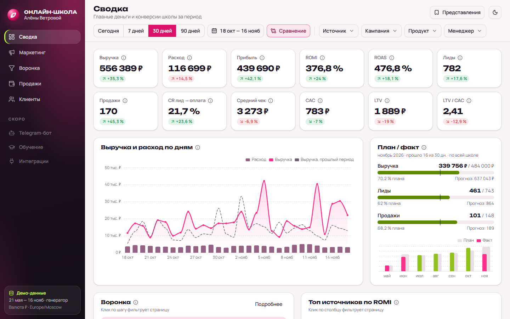
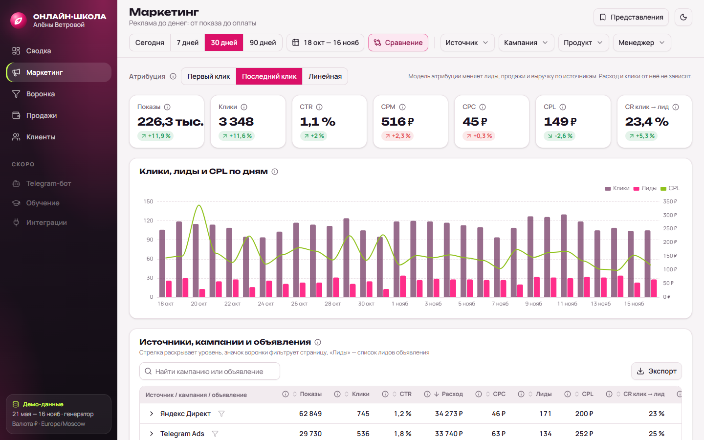
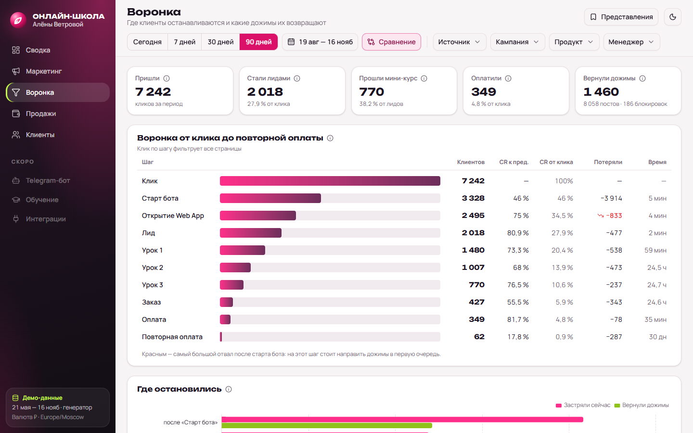
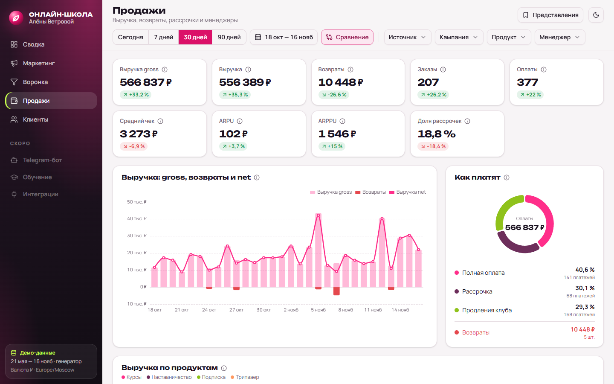
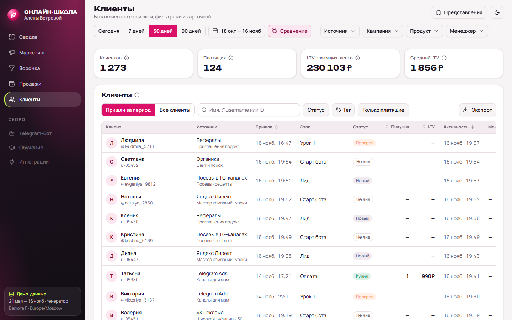
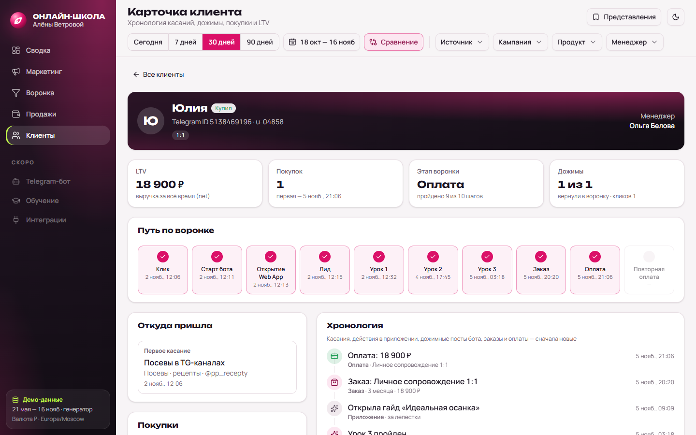
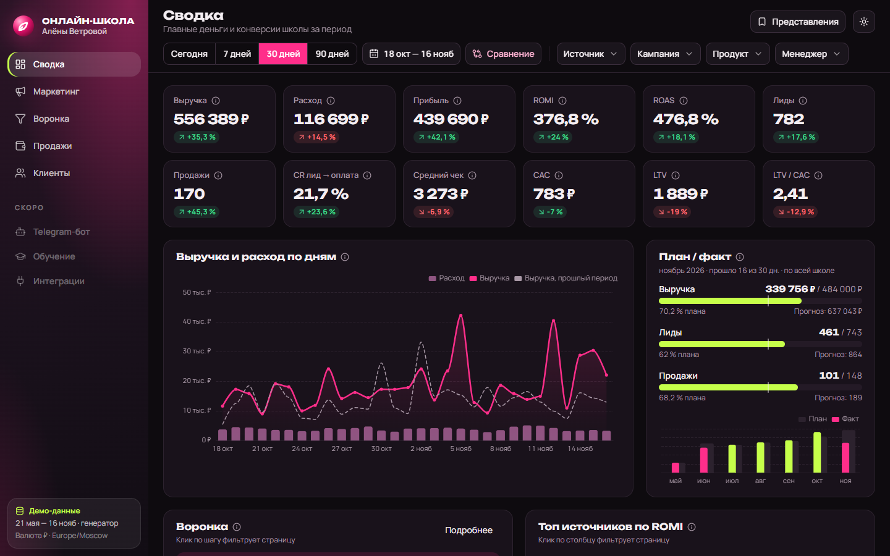
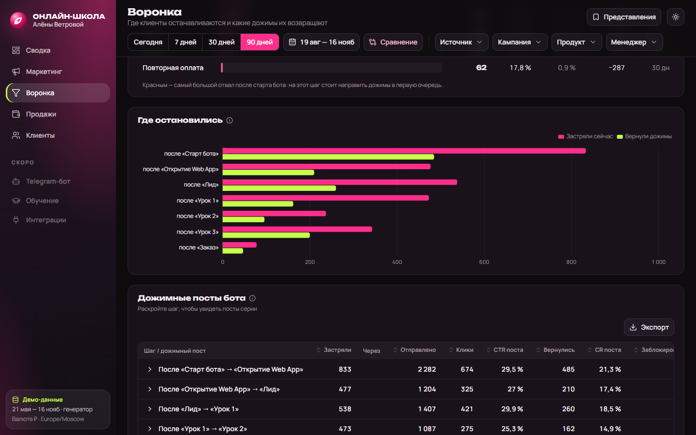
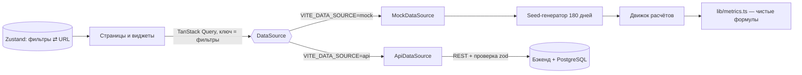

# Онлайн-школа Алёны Ветровой — админка со сквозной аналитикой

Демо-админка в стиле Power BI для Telegram Mini App онлайн-школы Алёны Ветровой (система «Лёгкость»).
Сквозная аналитика от клика по рекламе до повторной оплаты: деньги, маркетинг, воронка с дожимными постами бота, продажи, клиенты.

**Демо:** https://kozhevnikovaonline-beep.github.io/legkost-analytics/

Все данные сгенерированы. Архитектура позволяет подключить реальные данные (бот, Mini App, рекламные кабинеты, ЮKassa) без переписывания интерфейса: достаточно реализовать REST API по контракту ниже и включить `VITE_DATA_SOURCE=api`.

| Сводка | Маркетинг |
|---|---|
|  |  |
| **Воронка и дожимы** | **Продажи** |
|  |  |
| **Клиенты** | **Карточка клиента** |
|  |  |
| **Тёмная тема** | **Тёмная тема: воронка** |
|  |  |

## Что умеет

- **Сводка:**
  - 12 KPI: выручка, расход, прибыль, ROMI, ROAS, лиды, продажи, CR лид → оплата, средний чек, CAC, LTV, LTV/CAC;
  - у каждого KPI — изменение к прошлому периоду и формула в тултипе;
  - графики: выручка и расход по дням, мини-воронка, топ источников по ROMI, план/факт.
- **Маркетинг:**
  - показы, клики, CTR, CPM, CPC, CPL, CR клик → лид;
  - переключатель модели атрибуции: первый клик / последний клик / линейная;
  - таблица с drill-down: источник → кампания → объявление → лиды → карточка клиента.
- **Воронка:**
  - путь клик → старт бота → Web App → лид → уроки 1–3 → заказ → оплата → повторная оплата;
  - для каждого шага: CR к предыдущему и к первому шагу, потери, медианное время между шагами;
  - «Где остановились»: сколько клиентов застряло на каждом шаге;
  - эффективность дожимных постов бота: отправлено, клики, вернулись, блокировки;
  - разрез воронки по источникам.
- **Продажи:**
  - выручка gross и net, возвраты, заказы, оплаты;
  - средний чек, ARPU, ARPPU, доля рассрочек, структура оплат;
  - выручка по продуктам, рейтинг менеджеров с планом.
- **Клиенты:**
  - поиск, фильтры (статус, тег, только платящие), сортировка, страницы;
  - карточка клиента: путь по воронке, касания, хронология событий приложения, дожимов, заказов и оплат, LTV, теги.
- **Как в Power BI:**
  - **Слайсеры:** период (сегодня / 7 / 30 / 90 дней / свой диапазон), источник, кампания, продукт, менеджер.
  - **Кросс-фильтрация:** клик по столбцу, строке или шагу воронки фильтрует всю страницу.
  - **Активные фильтры** показаны чипами, каждый снимается крестиком.
  - **Фильтры хранятся в ссылке.** Пример: `#/marketing?p=30d&src=vk_ads&attr=linear`.
  - **Сохранённые представления** — в `localStorage`.
  - **Экспорт** таблиц в CSV (для русского Excel) и XLSX.
  - **Оформление:** светлая и тёмная темы, скелетоны при загрузке, пустые состояния.

## Стек

React 19 · TypeScript (strict) · Vite · Tailwind CSS 4 · shadcn/ui (Radix) · Apache ECharts · TanStack Table и Query · Zustand · date-fns · zod · Vitest · exceljs.
Деплой — GitHub Pages через GitHub Actions: тесты → сборка → публикация на каждый push в `main`.

## Запуск

```bash
npm install
npm run dev     # интерфейс
npm test        # 64 юнит-теста
npm run build   # проверка типов + сборка в dist/
npm run stats   # сводка по сгенерированным данным
node scripts/profit.ts      # форма прибыли демо-данных: убыточные дни, рост по месяцам
node scripts/screenshots.mjs # скриншоты для портфолио (нужен запущенный npm run dev и Edge/Chrome)
```

Требуется Node.js 22.18+. Переменные — в `.env` (пример в `.env.example`):

| Переменная | Значение |
|---|---|
| `VITE_DATA_SOURCE` | `mock` (по умолчанию) — генератор в браузере; `api` — REST API |
| `VITE_API_URL` | адрес бэкенда для `api`, например `https://api.example.ru` |

## Архитектура



- **UI знает только интерфейс `DataSource`** (`src/data/DataSource.ts`). Один метод соответствует одному виджету или экрану и одному эндпоинту бэкенда.
- **Реализация подгружается лениво** (`src/data/index.ts`): генератор, движок или клиент API не попадают в стартовый бандл. ECharts и exceljs тоже вынесены в отдельные чанки.
- **Формулы** — чистые функции в `src/lib/metrics.ts`, покрыты тестами. Деление на ноль даёт «нет данных», а не 0 или Infinity.
- **Атрибуция** — `src/lib/attribution.ts`. Лиды, продажи и выручка распределяются по касаниям клиента с весами модели, поэтому значения в разрезе объявлений могут быть дробными. Расход от модели не зависит.
- **Фильтры** — одно хранилище Zustand на все страницы (`src/store/filters.ts`), синхронизированное со строкой адреса.

```
src/
├─ app/            маршруты (hash-роутинг для GitHub Pages), разделы меню
├─ types/          domain.ts — типы домена; filters.ts; dto.ts — ответы DataSource
├─ data/
│  ├─ DataSource.ts       контракт
│  ├─ index.ts            выбор реализации, ленивая загрузка
│  ├─ mock/               rng, config, catalog, generate, engine, clients, MockDataSource
│  └─ api/ApiDataSource.ts  REST-клиент с проверкой ответов zod
├─ lib/            metrics, kpi, attribution, period, dates (МСК), format (Intl), export, urlFilters, labels
├─ store/          filters (⇄ URL), views (localStorage), theme
├─ hooks/          useData — запросы виджетов
├─ components/     ui (shadcn), layout, filters, widgets (KpiCard, ChartCard, DataTable, …), charts (ECharts)
└─ pages/          summary, marketing, funnel, sales, clients
tests/             metrics, attribution, generator, engine, marketing, funnel, sales, clients, filters
```

## Формулы

| Метрика | Формула |
|---|---|
| CTR | клики по платной рекламе / показы |
| CPC | расход / клики по платной рекламе |
| CPM | расход / показы × 1000 |
| CPL | расход / лиды |
| CR | шаг / предыдущий шаг |
| CAC | расход / новые клиенты |
| ROMI | (выручка − расход) / расход × 100% |
| ROAS | выручка / расход × 100% |
| Средний чек | выручка / оплаченные заказы |
| ARPU | выручка / пользователи бота на конец периода |
| ARPPU | выручка / платящие за период |
| LTV | выручка клиента за всё время, среднее по новым клиентам периода |
| Churn | ушедшие / клиенты на начало периода |
| CR дожима | вернулись на следующий шаг ≤ 72 ч после поста / отправлено |

Валюта — RUB, часовой пояс — Europe/Moscow (UTC+3 без перехода на летнее время). **Лид** — пользовательница, прошедшая приветствие в Web App. **Выручка** — net: оплаты минус возвраты.

## Демо-данные

Seed-генератор (`src/data/mock/generate.ts`, параметры — `config.ts`): одинаковый результат при каждом запуске, 180 дней до сегодняшнего дня, без событий «из будущего».

- **Объёмы:** ~14,7 тыс. визитов, ~3,3 тыс. лидов, ~600 оплаченных заказов за период.
- **Продукты и цены — как в Mini App:**
  - гайды 290–590 ₽;
  - марафон 990 ₽;
  - клуб 990 ₽/мес;
  - курсы 1 490–2 990 ₽;
  - групповой формат 1 990–4 790 ₽;
  - личное сопровождение 7 900–40 500 ₽.
- **6 источников** со своими CTR, CPC и качеством трафика: Яндекс Директ, VK Реклама, Telegram Ads, посевы в TG-каналах, органика, рефералы. VK Реклама убыточна, чтобы аналитике было что показать.
- **Путь клиента:** клик с utm → старт бота → Web App → лид → уроки → заказ → оплата. На каждом шаге, где клиентка остановилась, бот отправляет серию дожимных постов (15 постов на 7 шагов).
- **Динамика:** сезонность по дням недели, рост трафика и конверсии к концу периода.
- **Оплаты:** рассрочки, ~5% возвратов, продления клуба, повторные покупки, скидка лепестками до 20%.
- **Клиентки прошлого сезона:** участницы клуба и рассрочки 1:1 дают регулярную выручку с первого дня.
- **Прибыль** почти каждый день в плюсе и растёт от месяца к месяцу; это проверяется тестом.

## Контракт DataSource → REST API

Все методы принимают фильтры. В API они передаются той же строкой запроса, что и в адресе админки, плюс точные даты:
`?p=30d&from=2026-10-18&to=2026-11-16&src=vk_ads,tg_ads&camp=…&ad=…&prod=…&mgr=…&cmp=off&attr=linear&step=lesson_3`.

| Метод | Эндпоинт | Ответ |
|---|---|---|
| `getMeta()` | `GET /api/meta` | диапазон данных, валюта, таймзона |
| `getFilterOptions()` | `GET /api/filters/options` | источники, кампании, объявления, продукты, менеджеры |
| `getKpis(f)` | `GET /api/summary/kpis` | 12 KPI: значение, прошлый период, изменение, динамика по дням |
| `getRevenueSpendSeries(f)` | `GET /api/summary/revenue-spend` | выручка и расход по дням, прошлый период |
| `getTopSources(f)` | `GET /api/summary/top-sources` | платные источники: расход, выручка, продажи, ROMI |
| `getPlanFact(f)` | `GET /api/summary/plan-fact` | план и факт месяца, прогноз, история по месяцам |
| `getFunnel(f)` | `GET /api/funnel` | шаги воронки: количество, CR, потери, медианное время |
| `getStalls(f)` | `GET /api/funnel/stalls` | где остановились, дожимные посты и их эффективность |
| `getFunnelBySource(f)` | `GET /api/funnel/by-source` | воронка по каждому источнику |
| `getMarketingKpis(f)` | `GET /api/marketing/kpis` | показы, клики, CTR, CPM, CPC, CPL, CR клик → лид |
| `getDailyTraffic(f)` | `GET /api/marketing/daily` | клики, расход и лиды по дням |
| `getTrafficTable(f)` | `GET /api/marketing/traffic` | дерево источник → кампания → объявление с метриками |
| `getLeadsByAd(f, adId)` | `GET /api/marketing/ads/:adId/leads` | лиды объявления с долей атрибуции |
| `getSalesKpis(f)` | `GET /api/sales/kpis` | gross, net, возвраты, заказы, оплаты, средний чек, ARPU, ARPPU, доля рассрочек |
| `getSalesBreakdown(f)` | `GET /api/sales/breakdown` | выручка по продуктам, типы платежей, динамика |
| `getManagers(f)` | `GET /api/sales/managers` | рейтинг менеджеров и выполнение плана |
| `getClients(f, q)` | `GET /api/clients?segment&search&status&tag&onlyPaying&sort&desc&page&pageSize` | страница клиентов, итоги выборки, теги |
| `getClientById(id, f)` | `GET /api/clients/:id` | карточка: шаги, касания, заказы, хронология |

Формы ответов — `src/types/dto.ts`, схемы проверки — `src/data/api/ApiDataSource.ts`. Авторизация: Bearer-токен администратора (TODO в `ApiDataSource`).

## Схема PostgreSQL

Таблицы повторяют типы `src/types/domain.ts`. Деньги — целые рубли, время — `timestamptz` (UTC), отчётные дни считаются в `Europe/Moscow`.

```sql
CREATE TYPE source_id    AS ENUM ('yandex_direct','vk_ads','tg_ads','tg_seeding','organic','referral');
CREATE TYPE lead_status  AS ENUM ('new','warming','offer_sent','won','lost');
CREATE TYPE order_status AS ENUM ('created','paid','installment','refunded','cancelled');
CREATE TYPE payment_kind AS ENUM ('full','installment','subscription','refund');
CREATE TYPE product_cat  AS ENUM ('lead_magnet','tripwire','subscription','course','mentorship');
CREATE TYPE stall_step   AS ENUM ('bot_start','webapp_open','lead','lesson_1','lesson_2','lesson_3','order');

CREATE TABLE sources   (id source_id PRIMARY KEY, name text NOT NULL, is_paid boolean NOT NULL);
CREATE TABLE campaigns (id text PRIMARY KEY, source_id source_id NOT NULL REFERENCES sources,
                        name text NOT NULL, utm_campaign text NOT NULL, start_date date NOT NULL, end_date date);
CREATE TABLE ads       (id text PRIMARY KEY, campaign_id text NOT NULL REFERENCES campaigns,
                        name text NOT NULL, utm_content text NOT NULL);
-- Короткие коды для ссылок на бота: t.me/<bot>?start=<code> (Telegram пропускает до 64 символов)
CREATE TABLE tracking_links (code text PRIMARY KEY, ad_id text NOT NULL REFERENCES ads, created_at timestamptz DEFAULT now());

CREATE TABLE ad_costs  (date date NOT NULL, ad_id text NOT NULL REFERENCES ads,
                        impressions int NOT NULL, clicks int NOT NULL, spend int NOT NULL,
                        PRIMARY KEY (date, ad_id));

CREATE TABLE managers  (id text PRIMARY KEY, name text NOT NULL, role text NOT NULL CHECK (role IN ('curator','sales')),
                        monthly_plan_rub int NOT NULL);

CREATE TABLE users     (id text PRIMARY KEY, tg_user_id bigint UNIQUE NOT NULL, first_name text NOT NULL, username text,
                        created_at timestamptz NOT NULL, manager_id text REFERENCES managers, referrer_id text REFERENCES users,
                        tags text[] NOT NULL DEFAULT '{}', bot_blocked_at timestamptz);

CREATE TABLE touchpoints (id text PRIMARY KEY, visitor_id text NOT NULL, user_id text REFERENCES users,
                        at timestamptz NOT NULL, source_id source_id NOT NULL, campaign_id text REFERENCES campaigns,
                        ad_id text REFERENCES ads, utm_source text, utm_medium text, utm_campaign text, utm_content text, utm_term text);
CREATE INDEX ON touchpoints (user_id, at);
CREATE INDEX ON touchpoints (at);

-- События бота и Mini App: bot_start, webapp_open, onboarded, lesson_completed, quiz_completed,
-- guide_unlocked, checkout_opened, nurture_clicked, bot_blocked
CREATE TABLE events    (id text PRIMARY KEY, user_id text NOT NULL REFERENCES users, at timestamptz NOT NULL,
                        type text NOT NULL, payload jsonb NOT NULL DEFAULT '{}');
CREATE INDEX ON events (user_id, at);
CREATE INDEX ON events (type, at);

CREATE TABLE leads     (id text PRIMARY KEY, user_id text UNIQUE NOT NULL REFERENCES users, created_at timestamptz NOT NULL,
                        status lead_status NOT NULL, manager_id text REFERENCES managers, lost_reason text);

CREATE TABLE products  (id text PRIMARY KEY, name text NOT NULL, category product_cat NOT NULL);
CREATE TABLE price_plans (product_id text REFERENCES products, id text, label text NOT NULL, price_rub int NOT NULL,
                        installment_months int, PRIMARY KEY (product_id, id));

CREATE TABLE orders    (id text PRIMARY KEY, user_id text NOT NULL REFERENCES users, lead_id text REFERENCES leads,
                        product_id text NOT NULL, plan_id text NOT NULL, manager_id text REFERENCES managers,
                        created_at timestamptz NOT NULL, list_price int NOT NULL, discount_rub int NOT NULL DEFAULT 0,
                        amount int NOT NULL, status order_status NOT NULL, installment_months int, is_repeat boolean NOT NULL,
                        FOREIGN KEY (product_id, plan_id) REFERENCES price_plans);
CREATE INDEX ON orders (created_at);

CREATE TABLE payments  (id text PRIMARY KEY, order_id text NOT NULL REFERENCES orders, user_id text NOT NULL REFERENCES users,
                        at timestamptz NOT NULL, amount int NOT NULL,            -- возврат — отрицательная сумма
                        kind payment_kind NOT NULL, installment_no int, provider text NOT NULL,
                        provider_charge_id text UNIQUE);                          -- идемпотентность вебхуков
CREATE INDEX ON payments (at);

CREATE TABLE nurture_messages (id text PRIMARY KEY, stall_step stall_step NOT NULL, ord int NOT NULL,
                        delay_minutes int NOT NULL, title text NOT NULL, body text NOT NULL, cta text NOT NULL, active boolean DEFAULT true);
CREATE TABLE nurture_deliveries (id text PRIMARY KEY, message_id text NOT NULL REFERENCES nurture_messages,
                        user_id text NOT NULL REFERENCES users, sent_at timestamptz NOT NULL,
                        status text NOT NULL CHECK (status IN ('sent','failed','blocked')),
                        clicked_at timestamptz, converted_at timestamptz);
CREATE INDEX ON nurture_deliveries (user_id, sent_at);

CREATE TABLE plan_targets (month char(7), metric text CHECK (metric IN ('revenue','leads','sales')), value int NOT NULL,
                        PRIMARY KEY (month, metric));
```

Для быстрых отчётов стоит добавить материализованные представления по дням: `daily_ad_costs`, `daily_payments`, `user_steps` (первое достижение шага) и `user_touch_shares` (веса атрибуции по трём моделям). Тогда эндпоинты сводятся к агрегатам по дням.

## План интеграций

| Источник | Как попадает в базу |
|---|---|
| **Реклама и посевы** | Генератор ссылок `t.me/<bot>?start=<code>`: код хранится в `tracking_links` и связан с объявлением. С сайта кнопка «В бота» передаёт utm из адреса так же |
| **Telegram-бот** (`miniapp/server`) | `/start <code>` → `touchpoints` + `events.bot_start`; блокировка (ответ 403) → `events.bot_blocked` |
| **Дожимные посты** | Планировщик на сервере бота: кто и на каком шаге остановился → отправка по `nurture_messages` → `nurture_deliveries`. Кнопка поста открывает Web App с `startapp=nurture_<id>` → `clicked_at`; переход на следующий шаг ≤ 72 ч → `converted_at`. Telegram не сообщает ботам о прочтении, поэтому вместо «прочитано» считаются клики и возвраты |
| **Mini App** | Уже отправляет действия на сервер (`/api/action`, авторизация по `initData`): открытие, приветствие, уроки, тест, гайды, открытие оплаты → `events` |
| **Оплаты** | `successful_payment` от Telegram или вебхуки ЮKassa → `payments` (рассрочки, продления, возвраты); идемпотентность по `provider_charge_id` |
| **Яндекс Директ** | Ежедневная выгрузка Reports API → `ad_costs` |
| **VK Реклама** | Ежедневная выгрузка статистики через API → `ad_costs` |
| **Telegram Ads** | Открытого API нет — загрузка CSV-отчёта в админке |
| **Посевы** | Форма в админке: канал, дата, стоимость → `ad_costs` |
| **Вход в админку** | Telegram Login Widget, доступ по списку Telegram ID администраторов и менеджеров |

**Важно для реального запуска:**
- **Хранение данных.** Персональные данные граждан РФ хранятся на серверах в России (152-ФЗ): VPS и управляемый PostgreSQL у российского провайдера.
- **Документы.** Нужны политика обработки персональных данных и согласие пользователя.

## Дальше

Когорты (Retention и LTV по месяцу первой покупки; страница временно скрыта), Telegram-бот (DAU/MAU, рассылки), обучение (доходимость курсов), настройки интеграций.
